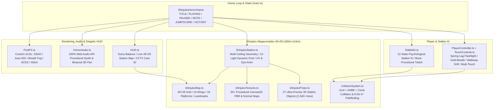

## はじめに：世界一複雑な地下迷宮「新宿駅」に、終電後閉じ込められたら？

毎日何百万人もの人々が行き交う世界最大のターミナル**「新宿駅」**。  
その地下1階（B1F）は、JR東日本の**東西自由通路**・**中央通路**・**全1〜16番線ホーム階段**を中心に、**東京メトロ丸ノ内線メトロプロムナード**、**西口地下広場（ロータリー吹き抜け）**、スバルビル跡地の**『新宿の目』**、西新宿・都庁方面へ伸びる**『動く歩道』**、**都営大江戸線・都営新宿線・小田急線・京王線**、さらに東側の**『新宿サブナード』**や南側の**『京王モール』『JR新南改札・バスタ新宿連絡コンコース』**までが網の目のように接続された、文字通りの**巨大地下迷宮（メガコンプレックス）**です。

> **「もし00:47の終電後、シャッターが閉まりきった新宿駅B1F全域にたった一人で取り残され、アルプス広場の展示ケースを内側から割って出てきた“2.2メートルの紫のうさぎ”が徘徊していたら……？」**

そんな着想から、**Three.js × TypeScript × WebGL（カスタムGLSLシェーダー）× Web Audio API** を駆使し、実物の写真・構内図と徹底的に見比べながら**180m × 116m（20,880㎡）の新宿地下街全域と27種類の駅構内オブジェクトを超精密・ウルトラフォトリアリスティックに3D再現した一人称サバイバルホラーゲーム『紫のうさぎ — 新宿駅 00:47』**を開発し、GitHub Pagesに公開しました。

---

## 🎮 今すぐブラウザでプレイ（インストール不要・PC／スマホ両対応）

- **公開URL（GitHub Pages）**: **https://github30.github.io/purple-rabbit-horror/**
- **GitHubリポジトリ**: **https://github.com/GitHub30/purple-rabbit-horror**

> 💡 **スマホ・タブレット対応**：ゲーム開始ボタンを押すと**自動的にフルスクリーン＆横画面（ランドスケープ）にロック**され、左親指バーチャルスティック＋右親指アクションパッドでコンソールゲームのように遊べます（もちろんPCのマウス視点ロック＋`WASD`操作にも対応）。

---

## 1. どこまで「本物の新宿駅」を再現したのか？（実物比較ギャラリー）

今回の開発で最もこだわったのは、**「新宿駅を毎日使っている人が見ても、自分が今どこに立っているか直感的にわかるレベルの空間・オブジェクト再現度」**です。  
しかも驚くべきことに、キャラクターの3Dモデル（`purple_rabbit_animated.glb`）以外の**駅建築・自動改札機・券売機・自販機・看板・床タイル・天井ルーバー・デジタルサイネージは、外部画像ファイルを1枚も使わず、すべてTypeScriptのコード（プロシージャルCanvas2D PBRテクスチャ＋Three.jsジオメトリ）だけで生成**しています。

### ① `45×29` グリッド（`180m × 116m` = `20,880 m²`）の新宿地下街全域マップ


`[M]`キー（スマホでは右下の「構内図」ボタン）で画面中央に開く**『JR新宿駅 B1F 地下街全域案内図』**です。現実の新宿駅B1Fとまったく同じ方位・トポロジーで以下の**全10エリア**がシームレスに繋がっています。

| 方角・エリア | 再現した実在施設・路線・ランドマーク | CCTVカメラID |
| :--- | :--- | :--- |
| **中央北（自由通路）** | **東西自由通路（全長100m）**、**『新宿ウォール456』（45.6m巨大LED）**、**『J・ADビジョン新宿駅』光柱10基**、**東口アルプス広場** | `CAM-E04` / `CAM-E03` |
| **中央（JR改札内）** | **西改札・東改札・中央西改札・中央東改札**、**全1〜16番線ホーム階段＆エスカレーター**、**5・6番線 成田エクスプレス(N'EX)連絡地下道** | `CAM-P14` / `CAM-P08` / `CAM-C02` / `CAM-JS1` / `CAM-NX5` |
| **中央壁面（窓口・券売）** | **地下みどりの窓口（マルス端末3席・窓口案内板）**、**きっぷうりば（EV20・MV50・Suicaチャージ機）**、**ルミネエスト新宿B1F**、**NewDays新宿** | `CAM-E04` / `CAM-LE1` |
| **西（西口広場・私鉄）** | **新宿西口地下広場（円形ロータリー吹き抜け天窓）**、**小田急線 西口地下改札 (OH01)**、**京王線 京王西口改札 (KO01)** | `CAM-W01` / `CAM-OH1` / `CAM-KO1` |
| **最西端（西新宿・都庁方面）** | **『新宿の目』（1969年 宮下芳子作・10m×3.4m）**、**西新宿4号街路地下道『動く歩道』（東西2レーン）**、**都営大江戸線 新宿西口駅 (E01)** | `CAM-EYE` / `CAM-MW1` / `CAM-E01` |
| **北（東京メトロ）** | **東京メトロ 丸ノ内線 新宿駅 (M08) 西改札・東改札**、**メトロプロムナード（スーパープレミアムウォール広告）** | `CAM-M08` |
| **北東〜東（地下街）** | **『新宿サブナード (SHINJUKU SUBNADE)』**（50周年アーバンジャングル木目＆ボタニカル天井・**サンデッキ広場**・**SUBNADE VISION**・西武新宿駅方面北口） | `CAM-SB1` / `CAM-SB2` / `CAM-SB3` |
| **南西（地下街・都営線）** | **『京王モール (KEIO MALL)』シャッター店舗街**、**都営新宿線 (S01)・京王新線・都営大江戸線 (E27) 連絡改札** | `CAM-KM1` / `CAM-S01` |
| **南（甲州街道・バスタ）** | **JR南口・甲州街道改札・バスタ新宿（4F直結）・NEWoMan・新南改札（QRコード対応EG21自動改札8通路）大コンコース** | `CAM-SG1` / `CAM-SE2` / `CAM-SC1` |
| **東端（脱出目標）** | **東口地下広場・歌舞伎町／アルタ方面 地上出口階段**（構内5か所のSuicaチャージ機で残高¥1,000を貯めると非常シャッター解錠） | `CAM-E01` |

さらにスマホ横画面（`844×390`）で構内図を開いた際にも、左右のバーチャルジョイスティックやアクションボタンと**1ピクセルも重ならない**よう、レスポンシブ計算（`width: min(440px, calc(100vw - 270px))`）を徹底しています。


---

### ② 西口スバルビル地下『新宿の目』（10.0m × 3.4m）と西新宿『動く歩道』

西口地下広場から西新宿・都庁方面へ進むと、1969年に彫刻家・宮下芳子氏が制作した全長10メートル・高さ3.4メートルの巨大アクリル彫刻**『新宿の目』**が現れます。


- 実物写真と照合し、**濃茶色のリセス壁面に浮かぶ上下6本の流線型アクリルリブ**、**左右の垂直リブ**、**左目頭の球体造形**、**放射状の虹彩（アイリス）と漆黒の瞳孔**、右下隅の銘板までを3Dジオメトリで忠実に再現。
- ホラー演出として、**プレイヤーが前を通るとアクリル内部の瞳孔がゆっくりとこちらを追尾して回転**し、ゲーム後半（チャージ進行後）には虹彩が不気味な血走った赤みを帯びます。

そのすぐ南側には、新宿副都心4号街路地下道の**『動く歩道（ムービングウォーク）』**が2レーン並行して伸びています。


- **溝付きアルミパレットベルトのUVスクロール**（北レーンは西行き、南レーンは東行きに逆方向スライド）に加え、プレイヤーがベルトの上に乗ると**実際に進行方向へ身体が運ばれる物理ドリフト（`±1.45 m/s`）**を実装。
- 両端の**黄色くし板（コムプレート）**、**3列の強化ガラス欄干**、**黒ゴムハンドレールの湾曲インレットブーツ**、**黄色スカートガードブラシ**、**赤色非常停止ボタン**、**緑矢印／赤進入禁止のLEDインジケーター**までマイクロメカニカルに作り込んでいます。

---

### ③ 50周年リニューアル『新宿サブナード』＆『京王モール』＆地下鉄連絡網

メトロプロムナード東端や東南口から接続する**『新宿サブナード (SHINJUKU SUBNADE)』**では、50周年リニューアルコンセプトである**「アーバンジャングル（Urban Jungle）」**の空間デザインを再現しました。


- **温かみのあるオーク材ルーバーとボタニカルグリーン帯を組み合わせた専用天井テクスチャ**、北側の**『サンデッキ広場』円形天窓オーキュラス**、円柱に巻き付く縦型デジタルサイネージ**『SUBNADE VISION』**、**オーク材と観葉植物プランターが一体化したラウンジベンチ**を配置。
- 南西側には、京王線西口改札から都営新宿線・大江戸線へと続く**『京王モール (KEIO MALL)』**と**『都営新宿線 (S01)・京王新線・都営大江戸線 (E27) 改札』**、さらに北西には**『都営大江戸線 新宿西口駅 (E01) 改札』**が広がります。


---

### ④ JR新南改札・バスタ新宿大コンコース ＆ 駅構内メカニックの超精密造形（Pass-2）

南側の**『JR新南改札・甲州街道改札／バスタ新宿 4F直結・NEWoMan』大コンコース**および東西自由通路では、JR東日本の駅設備をミリ単位のパーツ分割でモデリングしています。


- **JR自動改札機 EG20 / 新型QR対応 EG21**：傾斜したSuica ICタッチパッド、新型EG21特有の**手前側に傾いたQRコード光学スキャナー窓**、側面アクセントライン、ステンレスコーナーバンパー、床面配線コンジットプレート、垂直シアン／グリーンLEDレーン表示。
- **自動券売機 EV20・指定席券売機 MV50・のりこし精算機**：本体パネルから立体的に浮き出る**3×4金属テンキー（12キー＋キャンセル赤ボタン）**、透明アクリル製ICカードホルダーリップ、硬貨投入口ファンネル、紙幣挿入口フード、上部の緑色稼働ステータスランプ、頭上の内照式『山手線・中央線 運賃表』。
- **『みどりの窓口』ガラス内部**：反射を抑えたアンチグレアガラス越しに見える**3席のマルス（MARS）発券端末カウンター**、ティール色に光る液晶モニター、発券プリンター、飛沫防止アクリル板、天井から吊り下がる『1番窓口〜3番窓口』案内板、赤いベルベットロープの待機列パーテーション。
- **『acure』JR東日本エキナカ自販機**：ガラスディスプレイ内の**全42本の3Dペットボトル・アルミ缶に6種類の日本語飲料ラベルテクスチャ（緑茶・スポーツドリンク・烏龍茶・天然水・缶コーヒー・果汁飲料）を個別ラッピング**。赤色7セグLED価格表示、硬貨返却レバー、取出口フラップハンドルまで立体化。
- **全1〜16番線エスカレーター**：1段ずつ独立した金属ステップの**3辺（前端＋左右両端）を囲む黄色デマケーションライン**、乗降口のステンレスくし板、ハンドレールインレットブーツ、赤色非常停止ボタン。

---

## 2. システム全体アーキテクチャ

本作はゲームエンジン（Unity / Unreal Engine）を使わず、**Vite + TypeScript + Three.js** のみで構築しており、ビルド後のJSバンドルはわずか **約254 KB（gzip後）** です。



---

## 3. 技術解説①：外部画像ゼロ！Canvas2DによるプロシージャルPBR＆法線マップ生成

Webブラウザ向け3Dゲームで最もボトルネックになるのが「数十MBに及ぶテクスチャ画像のダウンロード待ち時間」です。  
本作では [`shinjukuTextures.ts`](https://github.com/GitHub30/purple-rabbit-horror/blob/main/app/src/station/shinjukuTextures.ts) にて、起動時にCanvas 2D APIで**カラーマップ・法線マップ（Normal Map）・ラフネスマップ・エミッシブマップの計50種類以上をメモリ上でプロシージャル生成**しています。

### ハイトマップ（高さ配列）からSobelフィルタで法線マップを動的生成する

たとえば、新宿駅構内の御影石（グラナイト）床タイルや黄色い点字ブロック（視覚障害者誘導用ブロック）、『動く歩道』の溝付き金属パレットベルトの凹凸は、グレースケールの高さ情報 $H(x, y)$ から偏微分（Sobel近似）で法線ベクトル $\vec{n} = (-dH/dx, -dH/dy, 1)$ を計算し、RGBテクスチャに変換しています。

```typescript
// app/src/station/shinjukuTextures.ts より抜粋・要約
function heightToNormalCanvas(
  w: number,
  h: number,
  sampleHeight: (x: number, y: number) => number,
  strength: number
): HTMLCanvasElement {
  const c = document.createElement('canvas');
  c.width = w;
  c.height = h;
  const ctx = c.getContext('2d')!;
  const img = ctx.createImageData(w, h);
  const d = img.data;

  const hGrid = new Float32Array(w * h);
  for (let y = 0; y < h; y++) {
    for (let x = 0; x < w; x++) {
      hGrid[y * w + x] = sampleHeight(x, y);
    }
  }

  for (let y = 0; y < h; y++) {
    const ym = ((y - 1 + h) % h) * w;
    const yp = ((y + 1) % h) * w;
    const yc = y * w;
    for (let x = 0; x < w; x++) {
      const xm = (x - 1 + w) % w;
      const xp = (x + 1) % w;
      const dx = (hGrid[yc + xp] - hGrid[yc + xm]) * strength;
      const dy = (hGrid[yp + x] - hGrid[ym + x]) * strength;
      const invLen = 1.0 / Math.hypot(dx, dy, 1.0);
      const nx = -dx * invLen;
      const ny = -dy * invLen;
      const nz = invLen;
      const idx = (yc + x) * 4;
      d[idx]     = Math.round((nx * 0.5 + 0.5) * 255);
      d[idx + 1] = Math.round((ny * 0.5 + 0.5) * 255);
      d[idx + 2] = Math.round((nz * 0.5 + 0.5) * 255);
      d[idx + 3] = 255;
    }
  }
  ctx.putImageData(img, 0, 0);
  return c;
}
```

この仕組みにより、懐中電灯のスポットライトが床面や点字ブロック、動く歩道の金属溝を斜めに照らした際、**本物の石材目地や突起のスペキュラハイライト（鏡面反射）がリアルタイムに浮かび上がります**。

---

## 4. 技術解説②：パラメトリック座標系による `35×23` → `45×29` メガコンプレックス拡張と脱出判定の隔離

当初 `35×23`（`140m × 92m`）だったJR新宿駅B1Fマップに対し、西側の**『新宿の目』『動く歩道』『都営大江戸線E01』『京王モール』『都営新宿線S01』**（西へ `+5` 列 = `+20m`）、北側の**『大江戸線E01北口』『サブナード・サンデッキ広場』**（北へ `+2` 行 = `+8m`）、東側の**『新宿サブナード』**、南側の**『JR南口・バスタ新宿・新南改札大コンコース』**を拡張する際、既存の百数十個のオブジェクト座標を手作業で書き換えると必ず座標ズレや壁埋まり（コリジョンバグ）が発生します。

そこで [`shinjukuMap.ts`](https://github.com/GitHub30/purple-rabbit-horror/blob/main/app/src/station/shinjukuMap.ts) にコアオフセット定数 `CORE_OX = 5`、`CORE_OZ = 2` を導入し、既存JRコンコースの座標系をすべてパラメトリックに平行移動させました。

```typescript
// app/src/station/shinjukuMap.ts
export const CELL = 4.0;
export const CORE_OX = 5; // 西方向へ +5列 (+20.0m) 拡張
export const CORE_OZ = 2; // 北方向へ +2行 (+8.0m) 拡張
export const COLS = 45;   // 東西 180.0m
export const ROWS = 29;   // 南北 116.0m
```

### 東口脱出階段（`C38`）と新宿サブナード（`C40..C43`）のシーケンスブレイク防止設計

現実の地理では、東口地上出口階段のさらに東〜北東に『新宿サブナード』が広がっています。  
もし以前のように「プレイヤーのX座標が東口ゲートラインを超えたら脱出成功（`player.position.x > VICTORY_X`）」という単純な不等号判定にしていると、**メトロプロムナード経由で新宿サブナード（`C40..C43`, `x = 160m〜176m`）へ歩いた瞬間に、シャッターを解錠していないのにゲームクリアになってしまう（あるいは解錠後にサブナードに入っただけでクリアになる）**という致命的なバグが起きます。

これを防ぐため、**①建築グリッド上の隔壁（`C39, R7..R11`）による物理的分離**と、**②東口階段室バウンディングボックスによる3次元スコープ判定**の二重防御を実装し、さらに `npx tsx` による自動A*経路監査スクリプトで検証しました。

```typescript
// app/src/main.ts：新宿サブナード (C40..43) への進入で誤発火しない東口階段室スコープ判定
if (
  this.exitGateUnlocked &&
  this.player.position.x > VICTORY_X_MIN &&
  this.player.position.x < VICTORY_X_MAX &&
  Math.abs(this.player.position.z - VICTORY_Z) < 5.5
) {
  this.triggerVictory();
  return;
}
```

---

## 5. 技術解説③：『新宿の目』瞳孔トラッキングと『動く歩道』ベルトドリフトの実装

### ① 『新宿の目』のプレイヤー追尾＆5段階浸食連動

[`shinjukuProps.ts`](https://github.com/GitHub30/purple-rabbit-horror/blob/main/app/src/station/shinjukuProps.ts) の `buildEyeOfShinjuku3D()` では、外側の流線型アクリルリブ群とは独立したシーングラフノードとして `pupilGroup`（虹彩ディスク＋瞳孔＋ガラスハイライト）を返し、毎フレーム [`ShinjukuStation.update()`](https://github.com/GitHub30/purple-rabbit-horror/blob/main/app/src/station/ShinjukuStation.ts) でプレイヤーとの相対ベクトルに応じて滑らかに追尾させています。

```typescript
// app/src/station/ShinjukuStation.ts
if (this.eyePupilGroup) {
  this.eyePupilGroup.rotation.z = elapsed * 0.18; // 虹彩のゆっくりとした催眠回転
  let targetX = Math.sin(elapsed * 0.35) * 0.24;
  let targetY = 0;
  if (playerPos) {
    const dxEye = playerPos.x - EYE_OF_SHINJUKU_POS.x;
    const dzEye = playerPos.z - EYE_OF_SHINJUKU_POS.z;
    const distEye = Math.hypot(dxEye, dzEye);
    // プレイヤーが16m以内に近づくと、瞳孔がプレイヤーの位置をじっと追う
    if (distEye < 16.0 && dzEye > -1.0) {
      targetX = Math.max(-0.56, Math.min(0.56, dxEye * 0.095));
      targetY = Math.max(-0.14, Math.min(0.14, (1.62 - EYE_OF_SHINJUKU_POS.y) * 0.25));
    }
  }
  this.eyePupilGroup.position.x += (targetX - this.eyePupilGroup.position.x) * Math.min(1, dt * 3.2);
  this.eyePupilGroup.position.y += (targetY - this.eyePupilGroup.position.y) * Math.min(1, dt * 3.2);
}
```

### ② 西新宿『動く歩道』の逆方向UVスクロールと物理ドリフト

『動く歩道』の北レーン（西・都庁方面行き）と南レーン（東・西口広場方面行き）は、同じパレットベルトテクスチャを `.clone()` して逆方向に `offset.x` を回しつつ、プレイヤーの足元座標 `(x, z)` がどちらのレーン上にあるかを判定して移動ベクトルに加算しています。

```typescript
// app/src/station/ShinjukuStation.ts
getMovingWalkwayDrift(x: number, z: number): number {
  if (x < MOVING_WALKWAY_SPAN.xStart || x > MOVING_WALKWAY_SPAN.xEnd) return 0;
  const dz = z - MOVING_WALKWAY_SPAN.zCenter;
  if (dz >= -1.18 && dz <= -0.14) return -1.45; // 北側ベルト：西（都庁・新宿の目）方向へ加速
  if (dz >= 0.14 && dz <= 1.18) return 1.45;    // 南側ベルト：東（西口広場）方向へ加速
  return 0;
}
```

紫のうさぎに追われている最中に進行方向の『動く歩道』へ飛び乗れば一気に距離を離せる一方、逆走レーンに足を踏み入れると足を取られて追いつかれるという、**実在の駅設備がそのままゲームプレイの駆け引きになる設計**です。

---

## 6. 技術解説④：48基以上の天井灯を60fpsで駆動する「12灯ダイナミック・ライトプール」と防眩（アンチグレア）PBR

`180m × 116m` の広大な地下空間には48基以上の天井蛍光灯・ダウンライトが存在しますが、WebGLで48個の `THREE.PointLight` を同時に有効化するとフラグメントシェーダーの負荷が爆発し、スマホではフレームレートが低下します。

そこで本作では、**すべての天井照明器具（48基以上）のメッシュ発光（`emissiveIntensity`）・床面ライトプール・フリッカー状態は毎フレーム計算しつつ、実際の `THREE.PointLight` インスタンスは12個のプール（`pointLightPool`）を使い回し、プレイヤーから最も近い上位12基の照明へ距離減衰付きで動的バインド**しています。

```typescript
// app/src/station/ShinjukuStation.ts：12個のPointLightプールで48基以上の照明を60fps駆動
const ranked = this.flickerLights
  .map((fl) => ({ fl, d: Math.hypot(fl.x - focusX, fl.z - focusZ) }))
  .sort((a, b) => a.d - b.d);

for (let i = 0; i < this.pointLightPool.length; i++) {
  const pl = this.pointLightPool[i];
  const entry = ranked[i];
  if (!entry || entry.d > 48) {
    pl.intensity = 0;
    continue;
  }
  const fade = Math.min(1, Math.max(0, (48 - entry.d) / 14));
  pl.position.set(entry.fl.x, entry.fl.y - 0.55, entry.fl.z);
  pl.color.setHex(entry.fl.currentColor);
  pl.intensity = entry.fl.currentIntensity * fade;
}
```

### 懐中電灯を当てても看板の文字が白飛びしない「アンチグレア内照マテリアル」

一人称ホラーでよくある失敗が、「内照式看板（`emissiveIntensity: 1.0`）に懐中電灯の強いスポットライトを当てると、拡散反射（Diffuse）と自己発光（Emissive）が加算されて真っ白に白飛びし、文字が読めなくなる」現象です。  
本作では、すべての内照式駅名標・案内板・券売機画面のベースアルベドを **`color: 0x485058`（ダークグレー）**、粗さを **`roughness: 0.72`** に抑え、自己発光を **`emissiveIntensity: 0.56〜0.64`** にキャリブレーションすることで、**暗闇ではくっきり自発光し、懐中電灯で照らしても文字が一切白飛びしない落ち着いた深夜駅の質感**を実現しました。

---

## 7. 技術解説⑤：『新宿ウォール456』5段階浸食と12状態ストーカーAI（`RabbitAI.ts`）

プレイヤーが構内5か所のSuicaチャージ機で¥200ずつチャージを進めるにつれ、東西自由通路の45.6m巨大LED**『新宿ウォール456』**、10基の**『J・ADビジョン新宿駅』**、天井の**コーブラインLED**、そして西口の**『新宿の目』**が5段階で同期しながら怪異に浸食されていきます。


そしてプレイヤーを追う2.2mの**紫のうさぎ（[`RabbitAI.ts`](https://github.com/GitHub30/purple-rabbit-horror/blob/main/app/src/ai/RabbitAI.ts)）**は、単なる最短経路追跡ではなく、以下の**12状態の心理ホラーステートマシン**で行動します。

1. `INTRO_SIT`：開始直後、東改札前に不気味に座り込んでいる。プレイヤーが近づくか最初のチャージを完了すると、ブラックアウトとともに立ち上がる。
2. `PATROL`：`45×29` グリッド上の全22か所のウェイポイントを8方向A*アルゴリズムで巡回。
3. `PEEK_CORNER`：プレイヤーの視界に入る直前、**『J・ADビジョン』の角柱や円柱の陰から大きな紫の耳と片目だけを傾けてこちらを覗き込む**。
4. `STARE_FREEZE`：プレイヤーと目が合うと、**首の骨が鳴る音とともにその場でピタリと静止して凝視**し、一拍置いて猛烈なチェイスへ移行する。
5. `ALERT_HOP` / `INVESTIGATE`：プレイヤーの足音、水たまりの水音、あるいは `[G]` キーで投げた**100円硬貨の落下音**を聞きつけて発生源へ跳躍調査。
6. `CHASE` / `LEAP_LUNGE`：半径 `14.5m` の電磁シャドウオーラで周囲の蛍光灯を激しく明滅・ドミノ破裂させながら追跡。
7. `CLOSET_INSPECT` / `SEARCH_CLOSET`：プレイヤーが**Suicaコインロッカー**や**緑の公衆電話ボックス（NTT MC-D8）**に隠れると、扉のすぐ外まで歩み寄ってスリットから中を覗き込み、爪で扉を引っ掻く。このとき **`[Space]` 長押し（スマホは「息を止める」ボタン長押し）で呼吸を止め、懐中電灯を消していないと扉をこじ開けられる**。

---

## 8. 技術解説⑥：シングルパスGLSLポストプロセス（`PostFX.ts`）と完全プロシージャル立体音響（`HorrorAudio.ts`）

### ① 呼吸によるレンズの曇り（Breath Fog）と暗順応（Auto-ISO）

[`PostFX.ts`](https://github.com/GitHub30/purple-rabbit-horror/blob/main/app/src/rendering/PostFX.ts) では、深度バッファを用いた **SSAO（スクリーンスペース・アンビエントオクルージョン）** と **ACES Filmic トーンマッピング** に加え、ロッカーや電話ボックス内で息を止めたり全力疾走で息が切れた際に**画面の周囲が自分の吐息で白く曇る `uBreathFog`** や、懐中電灯を消して闇に潜伏すると**人間の瞳孔が開いて暗部がうっすら見えてくる暗順応 `uAutoIso`** を1パスのフラグメントシェーダーで処理しています。

### ② 音声ファイル0個！Web Audio APIによる深夜の新宿駅サウンドスケープ

[`HorrorAudio.ts`](https://github.com/GitHub30/purple-rabbit-horror/blob/main/app/src/audio/HorrorAudio.ts) も外部 `.mp3` / `.wav` ファイルを一切使わず、すべて Web Audio API のオシレーター・フィルタ・コンボルバーリバーブ・バイノーラルパンナー（`StereoPannerNode`）でリアルタイム合成しています。

- **終電後の環境音**：地下変電設備の重低音ハムノイズ（`50Hz / 100Hz`）、換気ダクトの風切り音、水たまりの反響する水滴音。
- **新宿駅ならではの怪異イベント音**：
  - 誰もいない**証明写真機（Ki-Re-i）**の前を通りかかった瞬間に焚かれるストロボフラッシュ音。
  - 西口地下広場の**緑の公衆電話**が突然鳴り響くベル音。
  - 00:47で終電が終わったはずの**14・15番線ホーム頭上を、幽霊山手線が轟音と警笛を鳴らしながら通過するファントムトレイン現象**。
  - Suicaチャージ機やICカードの**実機そっくりの2連ビープ音（`1,760Hz → 2,093Hz`）**。

---

## おわりに：ブラウザとコードだけで「実在の巨大建築ホラー」はここまで作れる

「実際の新宿駅を、写真と見比べながら細部までウルトラフォトリアリスティックに再現する」という目標のもと、**`180m × 116m` の地下街メガコンプレックス**と**27種類の超精密3D駅構内オブジェクト**をすべてTypeScriptコードから構築しました。

- **今すぐ遊ぶ（GitHub Pages）**: https://github30.github.io/purple-rabbit-horror/
- **ソースコード（GitHub）**: https://github.com/GitHub30/purple-rabbit-horror

ぜひヘッドホンを着けて（スマホの方はそのままタップして横画面フルスクリーンで）、**終電後の新宿駅B1F・180m×116mの地下迷宮から5か所のSuicaチャージ機を巡って東口への脱出**に挑戦してみてください！  
「ここ、いつも通る新宿駅のあの場所だ！」と気づいた方や、Three.jsによるプロシージャル建築・PBR生成に興味を持っていただけた方は、ぜひ **いいね（LGTM）** と **ストック** で応援していただけると嬉しいです！
