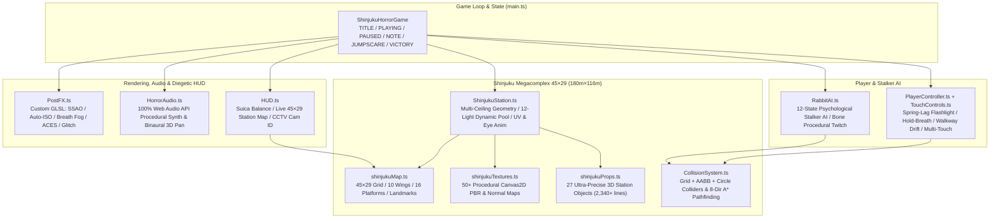

*終電後のJR新宿駅B1F・東西自由通路（『J・ADビジョン新宿駅』光柱列・『新宿ウォール456』・2.2mの紫のうさぎ）*

## はじめに：世界最大の地下迷宮「新宿駅」をコードだけで3D再現する

1日あたり世界最多の乗降客数を誇る巨大ターミナル**「新宿駅」**。  
その地下1階（B1F）は、JR東日本の**東西自由通路**・**中央通路**・**全1〜16番線ホーム階段**を核として、**東京メトロ丸ノ内線メトロプロムナード**、**西口地下広場（ロータリー吹き抜け）**、スバルビル跡地地下の**『新宿の目』**、西新宿・都庁方面へ伸びる**『動く歩道』**、**小田急線・京王線・都営新宿線・都営大江戸線**、さらに東側の**『新宿サブナード』**や南側の**『京王モール』『JR新南改札・バスタ新宿連絡コンコース』**までが立体的に絡み合う**超巨大地下迷宮（メガコンプレックス）**です。

:::message
**「もし00:47の終電後、すべてのシャッターが閉鎖された新宿駅B1F全域（180m × 116m = 20,880㎡）にたった一人で閉じ込められ、東口アルプス広場の展示ケースを内側から割って出てきた“2.2mの紫のうさぎ”が徘徊していたら？」**
:::

本記事では、ゲームエンジン（Unity / Unreal Engine）を一切使わず、**Three.js × TypeScript × カスタムGLSLシェーダー × Web Audio API** のみで実物の新宿駅B1F＆周辺地下街全域と**全27種類の駅構内オブジェクト**を超精密・ウルトラフォトリアリスティックに再現した一人称3Dサバイバルホラー**『紫のうさぎ — 新宿駅 00:47』**の設計と実装技術を解説します。

---

## 🎮 デモプレイ（ブラウザで即起動・PC／スマホ横画面フルスクリーン対応）

インストール不要で、以下のGitHub Pagesから今すぐプレイできます（gzip後バンドルサイズ **約254 KB**）。

https://github30.github.io/purple-rabbit-horror/

ソースコード一式はすべてGitHubで公開しています。

https://github.com/GitHub30/purple-rabbit-horror

:::message
**スマートフォン・タブレットでの操作について**  
タイトル画面の「新宿駅構内へ入る」をタップすると、Fullscreen API と Screen Orientation Lock API によって**自動的にフルスクリーン＆横画面（ランドスケープ）に固定**され、左親指バーチャルスティック＋右親指アクションパッドでコンソールゲームのように遊べます。
:::

---

## 1. 実物の写真・構内図と比較しながら再現した「新宿駅B1F＆地下街全域」

本作では、キャラクターモデル（`purple_rabbit_animated.glb`）以外の**駅建築・自動改札機・券売機・自販機・看板・床タイル・天井ルーバー・デジタルサイネージに至るまで、外部テクスチャ画像を1枚も読み込んでいません**。すべてTypeScriptのコード（プロシージャルCanvas2D PBR生成＋Three.jsジオメトリ）から動的生成しています。

### 1.1 `45×29` グリッド（`180m × 116m` = `20,880 m²`）の全体フロアプラン


*`[M]`キー（スマホは「構内図」ボタン）で中央表示される『JR新宿駅 B1F 地下街全域案内図（45×29グリッド）』*

実際のJR新宿駅構内図および周辺地下街マップと照合し、`1セル = 4.0m × 4.0m` の `45列 × 29行`（東西 `180m` × 南北 `116m`）のグリッド上に**全10エリア**をシームレスに構築しました。

| エリア区分 | 再現した実在エリア・路線・建築ディテール | 監視カメラID |
| :--- | :--- | :--- |
| **中央北（自由通路）** | **東西自由通路（100m）**、**『新宿ウォール456』（45.6m LED）**、**『J・ADビジョン新宿駅』光柱10基**、**東口アルプス広場** | `CAM-E04` / `CAM-E03` |
| **中央（JR改札内）** | **西改札・東改札・中央西改札・中央東改札**、**全1〜16番線ホーム階段＆エスカレーター**、**5・6番線 成田エクスプレス(N'EX)連絡地下道** | `CAM-P14` / `CAM-P08` / `CAM-C02` / `CAM-JS1` / `CAM-NX5` |
| **窓口・商業壁面** | **地下みどりの窓口（マルス端末3席）**、**きっぷうりば（EV20・MV50・Suicaチャージ機）**、**ルミネエスト新宿B1F**、**NewDays新宿** | `CAM-E04` / `CAM-LE1` |
| **西（西口広場・私鉄）** | **新宿西口地下広場（円形ロータリー吹き抜け）**、**小田急線 西口地下改札 (OH01)**、**京王線 京王西口改札 (KO01)** | `CAM-W01` / `CAM-OH1` / `CAM-KO1` |
| **最西端（西新宿方面）** | **『新宿の目』（1969年 宮下芳子作・10m×3.4m）**、**西新宿4号街路地下道『動く歩道』（東西2レーン）**、**都営大江戸線 新宿西口駅 (E01)** | `CAM-EYE` / `CAM-MW1` / `CAM-E01` |
| **北（東京メトロ）** | **東京メトロ 丸ノ内線 新宿駅 (M08) 西改札・東改札**、**メトロプロムナード（スーパープレミアムウォール広告）** | `CAM-M08` |
| **北東〜東（地下街）** | **『新宿サブナード (SHINJUKU SUBNADE)』**（50周年アーバンジャングル木目＆グリーン天井・**サンデッキ広場**・**SUBNADE VISION**） | `CAM-SB1` / `CAM-SB2` / `CAM-SB3` |
| **南西（地下街・都営）** | **『京王モール (KEIO MALL)』シャッター店舗街**、**都営新宿線 (S01)・京王新線・都営大江戸線 (E27) 連絡改札** | `CAM-KM1` / `CAM-S01` |
| **南（甲州街道・バスタ）** | **JR南口・甲州街道改札・バスタ新宿（4F直結）・NEWoMan・新南改札（QR対応EG21自動改札8通路）大コンコース** | `CAM-SG1` / `CAM-SE2` / `CAM-SC1` |
| **東端（脱出目標）** | **東口地下広場・歌舞伎町／アルタ方面 地上出口階段**（構内5か所のSuicaチャージ機で残高¥1,000を貯めると非常シャッター解錠） | `CAM-E01` |

また、モバイル横画面（`844×390`）で構内図を中央表示した際にも、左右のタッチ操作UI（ジョイスティックおよびアクションボタン群）と絶対に重ならないよう `width: min(440px, calc(100vw - 270px))` でレイアウトを制御しています。


*モバイル横画面（`844×390`）でも左右のタッチUIと一切干渉しない中央構内案内図*

---

### 1.2 西口スバルビル地下『新宿の目』（10.0m × 3.4m）と西新宿『動く歩道』

西口地下広場から西新宿・都庁方面へ進むと、1969年に彫刻家・宮下芳子氏が制作した幅10メートル・高さ3.4メートルの巨大パブリックアート**『新宿の目』**が北壁に現れます。


*1969年 宮下芳子作『新宿の目』（10.0m × 3.4m）。上下6本の流線型アクリルリブ、目頭球体、プレイヤーを追尾する瞳孔を3D再現*

その南側には、新宿副都心4号街路地下道の**『動く歩道（ムービングウォーク）』**が東西2レーン並行して設置されています。


*西新宿・都庁方面『動く歩道』。溝付きパレットベルト、黄色くし板、強化ガラス欄干3列、湾曲ハンドレールインレットブーツ、非常停止ボタン*

---

### 1.3 50周年リニューアル『新宿サブナード』・『京王モール』・『都営大江戸線 E01』

東〜北東エリアの**『新宿サブナード』**は、50周年リニューアルの「アーバンジャングル（Urban Jungle）」仕様として、**オーク木目ルーバーとボタニカルグリーン帯の天井**、**『サンデッキ広場』天窓オーキュラス**、円柱サイネージ**『SUBNADE VISION』**、**オーク材＆観葉植物プランターベンチ**を再現しました。


*『新宿サブナード』50周年アーバンジャングル仕様（木目ルーバー＆グリーン天井、シャッター店舗、プランター一体型ベンチ）*


*南西エリアの『京王モール』シャッター店舗街と、突き当たりの『都営新宿線 (S01)・京王新線・都営大江戸線 (E27) 改札』*


*北西エリアの『都営大江戸線 新宿西口駅 (E01) 改札』*

---

### 1.4 JR新南改札・バスタ新宿大コンコース ＆ 駅構内設備のマイクロメカニカル造形（Pass-2）

さらに、JR新宿駅の象徴である各種メカニック・什器類を実物写真と細部まで見比べ、ボタン・テンキー・QRリーダー・飲料ラベル・デマケーションライン単位まで3Dジオメトリ化しました。


*南大コンコースの『JR新南改札・甲州街道改札／バスタ新宿4F直結（NEWoMan）』。8通路のQR対応EG21自動改札機と閉鎖バリケード*


*きっぷうりば：指定席券売機MV50・自動券売機EV20・Suicaチャージ機（立体3×4金属テンキー、アクリルカードホルダー、硬貨ファンネル、上部稼働表示灯、頭上運賃表）*


*『みどりの窓口 Ticket Office』ガラス内部：マルス（MARS）端末3席、発券プリンター、飛沫防止パーティション、『1〜3番窓口』吊り下げ案内板、ベルベットロープ*


*『acure』JR東日本エキナカ自販機：42本の3Dボトル・アルミ缶すべてに6種の日本語飲料ラベルを個別ラッピング、赤色7セグLED価格表示、返却レバー*


*JR西改札の『EG20/EG21自動改札機』（傾斜QRコードスキャナー窓・垂直LEDレーン表示・床面配線プレート）*


*15・16番線ホーム連絡階段＆エスカレーター（ステップ3辺の黄色デマケーションライン、ステンレスくし板、ハンドレールインレットブーツ、赤色非常停止ボタン）*


*壁面『JR新宿駅 B1F 構内案内図』とJR東日本仕様の『AED 自動体外式除細動器』収納キャビネット（内部のオレンジ色AED本体・緑色ステータスLED・突出フラッグ標識）*

---

## 2. アーキテクチャ全体像

エンジン非依存の **Vite + TypeScript + Three.js** 構成で、各モジュールを以下のように疎結合に分割しています。



---

## 3. コア実装解説

### 3.1 外部画像ゼロを実現する Canvas2D プロシージャルPBR＆Sobel法線マップ生成

Webブラウザ向け3Dゲームで外部テクスチャ画像（PNG/KTX2）を何十枚も配信すると初回ロードが重くなります。  
本作では `shinjukuTextures.ts` にて、起動時にCanvas 2Dで描画したハイトフィールド $H(x, y)$ にSobel近似フィルタを適用し、**御影石床タイル・黄色点字ブロック・コンクリート柱・動く歩道金属パレットの法線マップ（Normal Map）をメモリ上で高速生成**しています。

```ts:app/src/station/shinjukuTextures.ts
function heightToNormalCanvas(
  w: number,
  h: number,
  sampleHeight: (x: number, y: number) => number,
  strength: number
): HTMLCanvasElement {
  const c = document.createElement('canvas');
  c.width = w;
  c.height = h;
  const ctx = c.getContext('2d')!;
  const img = ctx.createImageData(w, h);
  const d = img.data;

  const hGrid = new Float32Array(w * h);
  for (let y = 0; y < h; y++) {
    for (let x = 0; x < w; x++) {
      hGrid[y * w + x] = sampleHeight(x, y);
    }
  }

  for (let y = 0; y < h; y++) {
    const ym = ((y - 1 + h) % h) * w;
    const yp = ((y + 1) % h) * w;
    const yc = y * w;
    for (let x = 0; x < w; x++) {
      const xm = (x - 1 + w) % w;
      const xp = (x + 1) % w;
      const dx = (hGrid[yc + xp] - hGrid[yc + xm]) * strength;
      const dy = (hGrid[yp + x] - hGrid[ym + x]) * strength;
      const invLen = 1.0 / Math.hypot(dx, dy, 1.0);
      const nx = -dx * invLen;
      const ny = -dy * invLen;
      const nz = invLen;
      const idx = (yc + x) * 4;
      d[idx]     = Math.round((nx * 0.5 + 0.5) * 255);
      d[idx + 1] = Math.round((ny * 0.5 + 0.5) * 255);
      d[idx + 2] = Math.round((nz * 0.5 + 0.5) * 255);
      d[idx + 3] = 255;
    }
  }
  ctx.putImageData(img, 0, 0);
  return c;
}
```

### 3.2 パラメトリック座標系（`CORE_OX`, `CORE_OZ`）による `45×29` 拡張と東口脱出判定の隔離

既存のJR新宿駅コンコース（`35×23`）の周囲に、西側の『新宿の目』『動く歩道』『大江戸線E01』『京王モール』『都営新宿線S01』（西へ `+5` 列 = `+20m`）、北側の『大江戸線E01北口』『サブナード・サンデッキ広場』（北へ `+2` 行 = `+8m`）、東側の『新宿サブナード』、南側の『JR南口・バスタ新宿・新南改札大コンコース』を拡張する際、全オブジェクト座標を `CORE_OX = 5`, `CORE_OZ = 2` でパラメトリックにオフセットさせました。

:::message alert
**地理的拡張に伴うシーケンスブレイク（脱出判定バグ）の罠**  
現実の新宿駅では、東口地上出口階段（`C38`）のさらに東側に『新宿サブナード』（`C40..C43`）が位置しています。そのため、従来のような `player.position.x > VICTORY_X` というX座標のみの脱出判定だと、**メトロプロムナード経由で新宿サブナード（`x = 160m〜176m`）に足を踏み入れた瞬間に東口シャッターを無視してクリア判定が発火する**問題が生じます。
:::

そこで、以下の**二重の隔離設計**を導入し、`npx tsx` による自動A*経路監査スクリプトで検証しました。

1. **建築グリッド上の隔壁（`C39, R7..R11`）**：東口出口階段室（`C38, R8..R10`）と新宿サブナード（`C40..C43`）の間を物理壁で完全に遮断。
2. **東口階段室3Dバウンディングボックス判定**：`VICTORY_X_MIN`〜`VICTORY_X_MAX` かつ `|z - VICTORY_Z| < 5.5` の東口階段室内のみを脱出ゴールとしてスコープ化。

```ts:app/src/main.ts
// 新宿サブナード (C40..43) への進入で誤発火しない東口階段室スコープ判定
if (
  this.exitGateUnlocked &&
  this.player.position.x > VICTORY_X_MIN &&
  this.player.position.x < VICTORY_X_MAX &&
  Math.abs(this.player.position.z - VICTORY_Z) < 5.5
) {
  this.triggerVictory();
  return;
}
```

### 3.3 『新宿の目』の瞳孔追尾ギミックと『動く歩道』の物理ベルトドリフト

『新宿の目』は固定オブジェクトではなく、外側のアクリルリブ群とは独立した `pupilGroup` を毎フレーム更新し、プレイヤーが半径 `16m` 以内に近づくと瞳孔がプレイヤーのX/Y座標を滑らかに追尾します。

```ts:app/src/station/ShinjukuStation.ts
// 1. 西新宿『動く歩道』の逆方向UVスクロール（北ベルト＝西行き／南ベルト＝東行き）
if (this.movingBeltWestTex) {
  this.movingBeltWestTex.offset.x = (this.movingBeltWestTex.offset.x + dt * 0.42) % 1;
}
if (this.movingBeltEastTex) {
  this.movingBeltEastTex.offset.x = (this.movingBeltEastTex.offset.x - dt * 0.42 + 1) % 1;
}

// 2. 宮下芳子作『新宿の目』：催眠的な虹彩回転＋プレイヤー追尾瞳孔
if (this.eyePupilGroup) {
  this.eyePupilGroup.rotation.z = elapsed * 0.18;
  let targetX = Math.sin(elapsed * 0.35) * 0.24;
  let targetY = 0;
  if (playerPos) {
    const dxEye = playerPos.x - EYE_OF_SHINJUKU_POS.x;
    const dzEye = playerPos.z - EYE_OF_SHINJUKU_POS.z;
    const distEye = Math.hypot(dxEye, dzEye);
    if (distEye < 16.0 && dzEye > -1.0) {
      targetX = Math.max(-0.56, Math.min(0.56, dxEye * 0.095));
      targetY = Math.max(-0.14, Math.min(0.14, (1.62 - EYE_OF_SHINJUKU_POS.y) * 0.25));
    }
  }
  this.eyePupilGroup.position.x += (targetX - this.eyePupilGroup.position.x) * Math.min(1, dt * 3.2);
  this.eyePupilGroup.position.y += (targetY - this.eyePupilGroup.position.y) * Math.min(1, dt * 3.2);
}
```

さらに `PlayerController.update()` に `getWalkwayDrift(x, z)` を渡し、『動く歩道』に乗っている間はベルト進行方向へ `±1.45 m/s` の物理速度ベクトルが加算されるようにしています。

### 3.4 48基以上の照明を60fpsで駆動する「12灯ダイナミック・ライトプール」と防眩（アンチグレア）PBR

`180m × 116m` の全域に配置された48基以上の天井照明すべてに `THREE.PointLight` を割り当てるとモバイルGPUではシェーダー負荷が限界を超えます。  
そこで、全48基の蛍光灯メッシュ発光・床面グロウ・フリッカー状態は毎フレーム更新しつつ、**実際の `THREE.PointLight` は12個のプール（`pointLightPool`）のみを生成し、プレイヤーに最も近い上位12基へ距離フェード付きで動的バインド**しています。

また、懐中電灯のスポットライトを看板やガラスに当てた際に白飛び（グレア）しないよう、以下のマテリアル設計を徹底しました。

- **内照式駅名標・案内板・券売機画面**：ベースカラーを `0x485058`（ダークグレー）、`roughness: 0.72`、`emissiveIntensity: 0.56〜0.64` に設定。暗闇では鮮やかに浮かび上がり、懐中電灯で照らしても文字が一切白飛びしません。
- **電話ボックス・みどりの窓口・私鉄改札ガラス**：`opacity: 0.11`, `roughness: 0.28`, `clearcoat: 0.12` に抑え、懐中電灯の鏡面反射で内部の3D造形（MC-D8公衆電話やマルス端末）が潰れないように調整しています。

### 3.5 『新宿ウォール456』5段階連動浸食と12状態ストーカーAI（`RabbitAI.ts`）

Suicaチャージ機（全5か所）を起動するごとに、東西自由通路の**『新宿ウォール456』**、10基の**『J・ADビジョン新宿駅』**、天井の**コーブラインLED**、そして**『新宿の目』**の虹彩が5段階で連動して真紅の怪異表示へと浸食されていきます。


*チャージ進行に伴い『新宿ウォール456』・『J・ADビジョン』・天井コーブLEDが真紅に浸食された東西自由通路*

:::details 紫のうさぎ（RabbitAI.ts）の12状態ステートマシン詳細
1. **`INTRO_SIT`**：開始直後、東改札前に座り込んでいる。接近または初回チャージでブラックアウトとともに起床。
2. **`PATROL`**：`45×29` グリッド上の22か所のウェイポイントを8方向A*アルゴリズムで巡回。
3. **`PEEK_CORNER`**：『J・ADビジョン』角柱や円柱の陰から、大きな紫の耳と片目だけを傾けてプレイヤーを覗き込む。
4. **`STARE_FREEZE`**：視線が合うと首の骨を鳴らして完全静止し、凝視の後に猛烈なチェイスへ移行。
5. **`ALERT_HOP` / `INVESTIGATE`**：足音・水たまり音・投擲した100円硬貨の落下音（`[G]`キー）へ跳躍調査。
6. **`CHASE` / `LEAP_LUNGE`**：半径 `14.5m` の電磁シャドウオーラで周囲の蛍光灯を明滅・ドミノ破裂させながら追跡。
7. **`CLOSET_INSPECT` / `SEARCH_CLOSET`**：Suicaコインロッカーや公衆電話ボックスの前に立ち止まり、スリットから中を覗き込んで爪で扉を引っ掻く。プレイヤーは `[Space]` 長押し（スマホは「息を止める」長押し）で息を止め、ライトを消さなければ発見される。
8. **`EERIE_DANCE` / `JUMPSCARE`**：不気味なダンスモーションおよび捕獲時のジャンプスケア演出。
:::

---

## まとめ

「現実の新宿駅B1Fと周辺地下街を、写真と見比べながら細部までウルトラフォトリアリスティックに再現する」という目標のもと、**`180m × 116m` の地下街メガコンプレックス**と**27種類の超精密3Dオブジェクト**を外部画像ゼロ・TypeScriptコードのみで構築しました。

ぜひヘッドホンを着けて、深夜00:47の新宿駅地下迷宮からの脱出に挑戦してみてください！

https://github30.github.io/purple-rabbit-horror/
